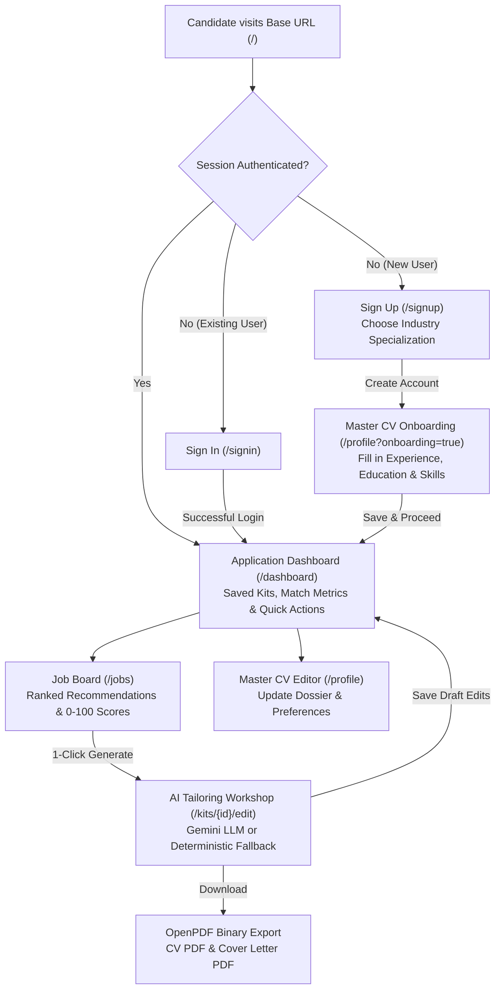
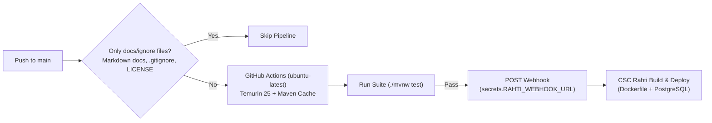

# JobApp — Multi-Industry Job Discovery & AI Application Tailoring Platform

[](https://github.com/A2p3kt/job-app/actions/workflows/ci-cd.yml)
[](https://openjdk.org/projects/jdk/21/)
[](https://spring.io/projects/spring-boot)
[](#testing)
[](#tech-stack)
[](#deployment-docker--cicd-pipeline)
[](#tech-stack)

**JobApp** is a full-stack career acceleration and application automation platform built with **Java 21+** and **Spring Boot 4**. It aggregates live job openings across multiple public job feeds, ranks opportunities objectively on a **0–100 scale** against a candidate's master dossier, tailors ATS-ready CVs and cover letters using **Google Gemini** (with a deterministic offline template fallback), and streams print-ready PDFs via **OpenPDF**.

---

## Table of Contents

- [Overview & Industry Coverage](#overview--industry-coverage)
- [End-to-End Application Flow](#end-to-end-application-flow)
- [Two-Tier Compatibility Matching & Scoring Engine](#two-tier-compatibility-matching--scoring-engine)
- [Core Features](#core-features)
- [Architecture & Repository Layout](#architecture--repository-layout)
- [RESTful API Reference (`/api/v1/**`)](#restful-api-reference-apiv1)
- [Getting Started (Local Development)](#getting-started-local-development)
- [Deployment, Docker & CI/CD Pipeline](#deployment-docker--cicd-pipeline)
- [Tech Stack & Testing](#tech-stack--testing)
- [Roadmap & Contributing](#roadmap--contributing)

---

## Overview & Industry Coverage

Job hunting across multiple portals involves repetitive filtering, keyword guesswork, and manual formatting for every application. JobApp centralizes this workflow into a single workspace:

1. Maintain one structured **Master Career Dossier** (summary, skills, preferences, experiences, education, certifications, and projects).
2. Automatically ingest and sanitize listings from **JobTech Nordics**, **Remotive**, and **Arbeitnow**.
3. Rank every posting with transparent, rule-based **0–100 compatibility scoring** and visual rationale badges.
4. Generate tailored CV Markdown and formal cover letters via **Google Gemini AI** or a deterministic generator, refine them in a split-screen editor, and export **A4 PDFs** in one click.

### Supported Industry Verticals

| Vertical | Enum Key | Example Roles |
| :--- | :--- | :--- |
| **Technology & IT** | `TECHNOLOGY` | Backend Engineers, Cloud Architects, DevOps, Data Scientists |
| **Marketing & Communications** | `MARKETING` | SEO Specialists, Copywriters, Campaign Managers, Media Leads |
| **Law & Legal Services** | `LAW_LEGAL` | Corporate Counsel, Compliance Specialists, Contract Lawyers |
| **Service & Facility Operations** | `SERVICE_OPERATIONS` | Facility Managers, Sanitation Specialists, Maintenance Techs |
| **Business, Administration & Finance** | `BUSINESS_FINANCE` | Financial Analysts, Accountants, Controllers, Operations Leads |
| **Healthcare & Nursing** | `HEALTHCARE` | Registered Nurses, Clinical Staff, Primary Care Specialists |

---

## End-to-End Application Flow



---

## Two-Tier Compatibility Matching & Scoring Engine

Every job posting in the database is evaluated by `MatchingEngineService` against the candidate's `MasterProfile` and `ProfileItem` collection, producing an integer score from **0 to 100** alongside transparent rationale badges.

### Scoring Formula

```text
Tier 1 — Explicit Preferences (0–40) = min(40, Location Match [0–20] + Target Role Tags [0–20])
Tier 2 — Profile Evidence (0–60)     = min(60, Skills Overlap [0–40] + Background Evidence [0–20])
Raw Composite Score (0–100)          = Tier 1 + Tier 2

Final Score = clamp(0, 100, Raw Composite Score)                  // Job category == candidate specialization
            = clamp(0, 100, round(Raw Composite Score * 0.60))    // Cross-industry (40% penalty)
```

### Scoring Rules Breakdown

| Component | Max Points | Exact Calculation Rule in `MatchingEngineService` |
| :--- | :---: | :--- |
| **Location Match** | **20** | **20 pts** if a preferred city/municipality appears in the job location (case-insensitive substring), or if the candidate lists `Remote` and the job location mentions `remote`, `hybrid`, or `worldwide`. **12 pts** neutral default when preferred locations are left blank; **0 pts** otherwise. |
| **Target Role Tags** | **20** | Word-boundary regex match of each candidate `preferredTags` entry against `title + extractedTags + description`: `round((matchedTags / totalPreferredTags) * 20)`. **12 pts** neutral default when preferred tags are blank. |
| **Skills Overlap** | **40** | **When job has extracted tags:** `round((matchedJobTags / totalJobTags) * 35)` (matching exact skills or case-insensitive containment), plus **+3 pts** for each additional unmatched candidate skill appearing with word boundaries in the title or description (capped at 40).<br/>**Fallback (no job tags):** **+8 pts** per candidate skill matched in title or description (capped at 40). |
| **Background Evidence** | **20** | Accumulates evidence across structured items (capped at 20):<br/>• `EXPERIENCE`: **+5 pts** per entry matching a job title word (>3 chars) or job tag in title/description.<br/>• `CERTIFICATION`: **+5 pts** per entry matching a job tag or mentioned in job title/description.<br/>• `EDUCATION`: **+3 pts** per entry with a non-blank institution.<br/>• `PROJECT`: **+3 pts** per entry whose description contains a job tag.<br/>• **Summary relevance:** **+2 pts** one-time bonus if any job tag appears in `summary`. |
| **Specialization Multiplier** | `1.00×` / `0.60×` | Matching specialization preserves `100%` of the raw score; cross-industry postings receive a **40% penalty** (`round(rawScore * 0.60)`) so in-domain opportunities surface first. |

### Worked Scoring Examples

#### Example 1: In-Industry Match (`TECHNOLOGY` Candidate vs. *Senior Backend Engineer*)

* **Candidate Profile:**
  * **Specialization:** `TECHNOLOGY`
  * **Preferred Locations:** `Helsinki, Remote`
  * **Target Role Tags (4):** `Backend, Cloud, Microservices, Distributed Systems`
  * **Skills:** `Java, Spring Boot, PostgreSQL, Docker, Kubernetes, AWS, Git`
  * **Background Items:**
    * *Experience:* `Senior Java Backend Engineer` (`EXPERIENCE`)
    * *Certification:* `Oracle Certified Professional: Java SE 21` (`CERTIFICATION`)
    * *Education:* `M.Sc. in Computer Science` at `Aalto University` (`EDUCATION`)
    * *Project:* `Microservice Order Hub` describing `Spring Boot and Docker` (`PROJECT`)
    * *Summary:* Highlights building `Java` and `PostgreSQL` services
* **Job Posting:**
  * **Category:** `TECHNOLOGY` | **Title:** `Senior Backend Engineer` | **Location:** `Helsinki (Hybrid)`
  * **Extracted Tags (5):** `Java, Spring Boot, PostgreSQL, Docker, Kafka`
  * **Description Snippet:** *"Design resilient Backend Microservices deployed on AWS."*

| Scoring Step | Evaluation | Points Earned |
| :--- | :--- | :---: |
| **Location Match** | `"Helsinki"` matches `"Helsinki (Hybrid)"` | **20 / 20** |
| **Target Role Tags** | `2` of `4` tags matched (`Backend`, `Microservices`) → `round((2 / 4) × 20)` | **10 / 20** |
| **Tier 1 Subtotal** | `min(40, 20 + 10)` | **30 / 40** |
| **Skills Overlap** | `4` of `5` job tags matched (`Java`, `Spring Boot`, `PostgreSQL`, `Docker`) → `round((4 / 5) × 35) = 28`, plus unmatched skill `AWS` found in description (`+3`) | **31 / 40** |
| **Background Evidence** | Experience (`+5`) + Certification (`+5`) + Education (`+3`) + Project (`+3`) + Summary tag (`+2`) = `18` | **18 / 20** |
| **Tier 2 Subtotal** | `min(60, 31 + 18)` | **49 / 60** |
| **Specialization Multiplier** | `TECHNOLOGY == TECHNOLOGY` → `1.00×` (no penalty) | **`79 × 1.00`** |
| **Final Match Score** | `30 + 49 = 79` | **79 / 100** |

* **Generated Rationale Badges (up to 10):** `Specialization Match: Technology & IT`, `Location Match: Helsinki`, `Target Role Tag: Backend`, `Target Role Tag: Microservices`, `Skill Match: Java`, `Skill Match: Spring Boot`, `Skill Match: PostgreSQL`, `Skill Match: Docker`, `Skill in Description: AWS`, `Experience: Senior Java Backend Engineer`.

#### Example 2: Cross-Industry Penalty (`TECHNOLOGY` Candidate vs. *Financial Analyst*)

If the same `TECHNOLOGY` candidate inspects a *Financial Analyst* role (`BUSINESS_FINANCE`) located in `Helsinki` where location (`20 pts`) and transferable education/keywords yield a `Raw Composite Score` of `50`:

* Because `BUSINESS_FINANCE != TECHNOLOGY`, the engine applies the **0.60× cross-industry multiplier**: `round(50 × 0.60) = 30`.
* **Final Match Score:** **30 / 100**, badged with `Cross-Industry Opportunity (Business, Administration & Finance)`.

---

## Core Features

### 1. Authentication & Smart Root Routing (`AuthWebController`, `SecurityConfig`)
* **PBKDF2 Password Hashing:** Passwords are stored using `PBKDF2WithHmacSHA256` (`10,000` iterations, `256-bit` derived key, cryptographically secure `16-byte` random salt, and constant-time comparison).
* **Flexible Login:** Supports sign-in via either **username** or **email** (`/signin` or `/login`) and registration with initial industry selection (`/signup` or `/register`).
* **Smart Root Redirect (`GET /`):** Authenticated users land directly on `/dashboard`; first-time or signed-out visitors are routed to `/signin`.
* **Two-Step Onboarding:** Newly registered users are directed to `/profile?onboarding=true` with a guided onboarding banner to populate experience, education, and skills before entering the dashboard.

### 2. Candidate Application Dashboard (`/dashboard`)
* **Overview Metrics:** Displays total saved application kits (split into `FINALIZED` and `DRAFT`), average and peak match scores, total indexed market positions, and active specialization.
* **Application Kit Manager:** Table showing job title, company, location, industry badge, color-coded compatibility pill, status pill, and direct actions for **Edit Draft**, **CV PDF**, and **Cover Letter PDF**.
* **Profile Snapshot:** Surfaces active skills, contact info, and preferred locations with quick links to edit the master dossier or browse the job board.

### 3. Multi-Source Autonomous Job Ingestion (`JobScraperService`)
Aggregates listings from three zero-auth public APIs without requiring commercial API keys:

| Data Source | Coverage | Query Endpoint | Ingestion Prefix & Strategy |
| :--- | :--- | :--- | :--- |
| **JobTech Nordics** | Nordic multi-industry market | `GET /search?q={query}&limit=12` | `jobtech-{id}` — parses employer, municipality/city/country, and role text |
| **Remotive API** | Global remote roles | `GET /remote-jobs?category={slug}&limit=10` | `remotive-{id}` — captures remote location requirements and role metadata |
| **Arbeitnow API** | European multi-industry board | `GET /job-board-api` | `arbeitnow-{slug}` — dynamically infers sector from title, tags, and description |

**Ingestion Pipeline:**
1. **Deduplication:** Queries `existsByExternalId(...)` before persistence to skip already-indexed openings.
2. **Sanitization:** Strips HTML tags (`<p>`, `<div>`, `<br/>`, lists, headings), decodes HTML entities (`&amp;`, `&#39;`, quotes, dashes), and normalizes spacing.
3. **Word-Boundary Tagging:** Extracts domain skills using regex word boundaries (`Java` will not falsely match `JavaScript`).
4. **Execution Modes:** Runs automatically every hour via `@Scheduled(cron = "0 0 * * * *")` and on-demand via UI (`POST /jobs/scrape`) or REST (`POST /api/v1/jobs/scrape`).

### 4. Dual-Mode AI Tailoring & OpenPDF Export (`TailoringService`, `PdfExportService`)

```text
[ Candidate Profile ]               [ Target Job Posting ]
          │                                   │
          └─────────────────┬─────────────────┘
                            ▼
                    TailoringService
            ┌───────────────┴───────────────┐
            ▼                               ▼
   (Live Gemini API Key)           (Offline / Fallback Mode)
    Google Gemini LLM               Deterministic Template Generator
 (Primary + Model Fallback)        (Profile Skills + Chronological Items)
            │                               │
            └───────────────┬───────────────┘
                            ▼
                  ApplicationKit Entity
            (matchScore, tailoredCv, tailoredCoverLetter)
                            │
            ┌───────────────┴───────────────┐
            ▼                               ▼
    Split-Screen Workspace             PdfExportService
     (/kits/{kitId}/edit)            (Binary OpenPDF Stream)
   (Markdown Tabs & Live Edit)      (/pdf/cv & /pdf/cover-letter)
```

* **Resilience & Multi-Model Fallback:** When `GEMINI_API_KEY` is configured, `TailoringService` attempts inference using the configured `gemini.model` (default `gemini-3.1-flash-lite`) with automatic fallback to `gemini-3.1-flash-lite-preview` and `gemini-3.8-flash`. If no API key is present or upstream calls fail, it seamlessly switches to a deterministic generator built from the candidate's profile and `ProfileItem` history.
* **Split-Screen Editor (`kit-editor.html`):** Displays the job description and match rationale alongside editable tabs for CV Markdown and cover letter text.
* **A4 PDF Export (`PdfExportService`):** Streams styled OpenPDF documents for both ATS-friendly CVs (`/kits/{id}/pdf/cv`) and formal cover letters (`/kits/{id}/pdf/cover-letter`).

### 5. Idempotent Demo Seeding (`JobappApplication`)
On startup, the `CommandLineRunner` checks record counts across all five repositories (`AppUser`, `MasterProfile`, `ProfileItem`, `JobPosting`, `ApplicationKit`).
* **Fresh / Empty Database:** Seeds the demo account (`tolu` / `password123`), 1 enriched `MasterProfile`, 9 `ProfileItem` records, 7 multi-industry `JobPosting` entries, and 2 pre-built `ApplicationKit` drafts (`96%` `FINALIZED` and `92%` `DRAFT`).
* **Populated Database (Production / Persistent DB):** Immediately detects existing records, logs the counts, and skips seeding completely so user data is never overwritten or duplicated on restart.

<details>
<summary><strong>Seeded Demo Account Summary (click to expand)</strong></summary>

| Attribute | Seeded Value |
| :--- | :--- |
| **Credentials** | Username: `tolu` / Password: `password123` |
| **Candidate** | Toluwalase Ayoola — *Lead Cloud Architect & Senior Distributed Systems Engineer* (`TECHNOLOGY`) |
| **Skills** | Java 21, Spring Boot 4, Spring Cloud, Kubernetes, Docker, AWS (ECS, EKS, Lambda, RDS), PostgreSQL, Apache Kafka, Redis, Terraform, REST & GraphQL APIs, Microservices, CI/CD, Git, Linux |
| **Locations** | Helsinki, Espoo, Tampere, Stockholm, Remote |
| **Experience** | *Lead Backend Engineer & Distributed Systems Architect* @ Nordic Cloud Platforms Oy (2022–Present)<br/>*Senior Java Software Engineer* @ FinTech Solutions Nordics (2019–2022) |
| **Education** | *M.Sc. in Computer Science* @ Aalto University — School of Science<br/>*B.Sc. in Software Engineering* @ University of Helsinki |
| **Certifications** | AWS Certified Solutions Architect — Professional; Certified Kubernetes Administrator (CKA); Oracle Certified Professional: Java SE 21 Developer |
| **Projects** | JobApp Platform; Distributed Event Broker & In-Memory Key-Value Cache |

</details>

---

## Architecture & Repository Layout

JobApp follows a clean, intentional **3-layer package architecture** under `dev.toluwalase.jobapp` (`domain`, `service`, `web`) implemented in explicit, hand-written Java with constructor injection and zero annotation-processor code generation.

```text
job-app/
├── .github/workflows/
│   └── ci-cd.yml                           # GitHub Actions: Maven test suite + CSC Rahti webhook deploy
├── Dockerfile                              # Multi-stage build (Temurin 25 JDK builder -> JRE Alpine runtime)
├── pom.xml                                 # Spring Boot 4.1.2, Java 21 compile target, OpenPDF, Dotenv, Actuator
├── src/main/
│   ├── java/dev/toluwalase/jobapp/
│   │   ├── JobappApplication.java          # Bootstrap, RestClient/ObjectMapper beans & idempotent demo seeder
│   │   ├── domain/                         # Persistence Entities, Repositories & Value Objects (13 classes)
│   │   │   ├── AppUser.java / AppUserRepository.java
│   │   │   ├── ApplicationKit.java / ApplicationKitRepository.java
│   │   │   ├── JobCategory.java / JobMatchDto.java
│   │   │   ├── JobPosting.java / JobPostingRepository.java
│   │   │   ├── MasterProfile.java / MasterProfileRepository.java
│   │   │   └── ProfileItem.java / ProfileItemRepository.java / ProfileItemType.java
│   │   ├── service/                        # Business Logic & External Integrations (6 classes)
│   │   │   ├── GeminiProperties.java       # Typed configuration properties for Gemini API key & model
│   │   │   ├── JobScraperService.java      # Multi-source HTTP ingestion, HTML cleaner & tagger
│   │   │   ├── MatchingEngineService.java  # Specialization-aware two-tier 0–100 scoring engine
│   │   │   ├── PdfExportService.java       # OpenPDF CV & cover letter renderer
│   │   │   ├── ProfileService.java         # User account & MasterProfile/ProfileItem lifecycle
│   │   │   └── TailoringService.java       # Gemini LLM client with deterministic fallback
│   │   └── web/                            # Thymeleaf MVC, REST APIs & Security Utilities (9 classes)
│   │       ├── AuthWebController.java      # /signin, /signup, /signout & session handling
│   │       ├── DashboardWebController.java # /dashboard overview metrics & saved kits
│   │       ├── JobWebController.java       # /jobs ranked feed & manual scraper trigger
│   │       ├── KitWebController.java       # /kits/** editor views & PDF downloads
│   │       ├── ProfileWebController.java   # / smart redirect & /profile onboarding/editor
│   │       ├── JobApiController.java       # REST endpoints under /api/v1/jobs/**
│   │       ├── KitApiController.java       # REST endpoints under /api/v1/kits/**
│   │       ├── ProfileApiController.java   # REST endpoints under /api/v1/profile/**
│   │       └── SecurityConfig.java         # /api/** CORS policy & PBKDF2 hashing utility
│   └── resources/
│       ├── application.properties          # Dev config: H2 in-memory DB, /h2-console & .env import
│       ├── application-prod.properties     # Prod config: PostgreSQL env vars, H2 console disabled
│       └── templates/                      # Thymeleaf + Tailwind CSS views
│           ├── dashboard.html
│           ├── jobs.html
│           ├── kit-editor.html
│           ├── profile.html
│           ├── signin.html
│           └── signup.html
└── src/test/                               # 111 unit, slice & full-context tests mirroring app packages
```

---

## RESTful API Reference (`/api/v1/**`)

Alongside the server-rendered web UI, JobApp provides JSON and binary endpoints under `/api/v1/**` with CORS enabled for `/api/**` (`GET`, `POST`, `PUT`, `DELETE`, `OPTIONS`), plus Spring Boot Actuator health/info endpoints.

### Profile Endpoints
| Method | Route | Description |
| :--- | :--- | :--- |
| `GET` | `/api/v1/profile` | Retrieve the candidate's `MasterProfile` JSON |
| `PUT` | `/api/v1/profile` | Update headline, summary, skills, preferred locations, and tags |
| `GET` | `/api/v1/profile/items` | List all structured `ProfileItem` entries |
| `POST` | `/api/v1/profile/items` | Add a validated `ProfileItem` (`EXPERIENCE`, `EDUCATION`, `CERTIFICATION`, `PROJECT`) |
| `DELETE` | `/api/v1/profile/items/{id}` | Delete a specific `ProfileItem` owned by the profile |

### Job Discovery & Matching Endpoints
| Method | Route | Description |
| :--- | :--- | :--- |
| `GET` | `/api/v1/jobs/recommendations` | Ranked `JobMatchDto` recommendations sorted by match score (optional `?category=`) |
| `GET` | `/api/v1/jobs/{id}` | Retrieve a single `JobPosting` by primary ID |
| `POST` | `/api/v1/jobs/scrape` | Trigger on-demand ingestion across JobTech, Remotive, and Arbeitnow |

### Application Kit & PDF Endpoints
| Method | Route | Description |
| :--- | :--- | :--- |
| `GET` | `/api/v1/kits` | List all `ApplicationKit` records ordered by `updatedAt` descending |
| `POST` | `/api/v1/kits/generate/{jobId}` | Generate or fetch an existing tailored `ApplicationKit` for `jobId` |
| `GET` | `/api/v1/kits/{kitId}` | Retrieve a specific `ApplicationKit` |
| `PUT` | `/api/v1/kits/{kitId}` | Save edits to `tailoredCvContent` and `tailoredCoverLetterContent` |
| `GET` | `/api/v1/kits/{kitId}/pdf/cv` | Stream tailored CV as `application/pdf` |
| `GET` | `/api/v1/kits/{kitId}/pdf/cover-letter` | Stream tailored cover letter as `application/pdf` |

---

## Getting Started (Local Development)

### Prerequisites
* **Java 21+ JDK** (compiled for Java 21; CI and Docker target Eclipse Temurin 25)
* **Git**

### Quick Start

1. **Clone the repository:**
   ```bash
   git clone https://github.com/A2p3kt/job-app.git
   cd job-app
   ```

2. **Run the automated test suite using the bundled Maven Wrapper:**
   ```bash
   ./mvnw test
   ```

3. **Start the application locally (default H2 in-memory profile):**
   ```bash
   ./mvnw spring-boot:run
   ```

4. **Sign in via browser:**
   * Open `http://localhost:8080` (automatically redirects to `/signin`).
   * Register a new account at `/signup`, or sign in with the seeded demo credentials:
     * **Username:** `tolu`
     * **Password:** `password123`
   * The local H2 web console is available at `http://localhost:8080/h2-console` (`jdbc:h2:mem:jobappdb`, user `sa`, blank password).

### Optional `.env` Configuration (Gemini AI)

Both `application.properties` and `application-prod.properties` automatically import an optional `.env` file from the working directory (`spring-dotenv` + `spring.config.import=optional:file:.env[.properties]`). Without an API key, `TailoringService` operates in deterministic offline mode.

```properties
GEMINI_API_KEY=your-gemini-api-key-here
GEMINI_MODEL=gemini-3.1-flash-lite
```

---

## Deployment, Docker & CI/CD Pipeline

### 1. Production Profile (`application-prod.properties`)

Activate the `prod` profile (`--spring.profiles.active=prod` or `SPRING_PROFILES_ACTIVE=prod`) when deploying with PostgreSQL. In production mode, Hibernate connects to PostgreSQL with `ddl-auto=update`, and the H2 console is explicitly disabled.

| Variable | Required | Default | Description |
| :--- | :---: | :--- | :--- |
| `SPRING_PROFILES_ACTIVE` | Yes | `default` | Set to `prod` to enable PostgreSQL & disable H2 console |
| `DB_SERVICE_HOST` | Yes (prod) | — | PostgreSQL host / service address |
| `DB_SERVICE_PORT` | Yes (prod) | — | PostgreSQL port (e.g., `5432`) |
| `DB_NAME` | Yes (prod) | — | PostgreSQL database name |
| `DB_USER` | Yes (prod) | — | PostgreSQL username |
| `DB_PASSWORD` | Yes (prod) | — | PostgreSQL password |
| `GEMINI_API_KEY` | No | `""` | Google Gemini API key; falls back to template engine if unset |
| `GEMINI_MODEL` | No | `gemini-3.1-flash-lite` | Primary Gemini model identifier |

### 2. Multi-Stage Docker Image (`Dockerfile`)

The `Dockerfile` builds a compact runtime container in two stages using `eclipse-temurin:25-jdk` for compilation and `eclipse-temurin:25-jre-alpine` for execution:

```bash
# Build container image
docker build -t jobapp:latest .

# Run locally with in-memory H2
docker run -p 8080:8080 jobapp:latest

# Run against PostgreSQL using the prod profile
docker run -p 8080:8080 \
  -e SPRING_PROFILES_ACTIVE=prod \
  -e DB_SERVICE_HOST=postgres \
  -e DB_SERVICE_PORT=5432 \
  -e DB_NAME=jobapp \
  -e DB_USER=jobapp_user \
  -e DB_PASSWORD=secret \
  -e GEMINI_API_KEY=your-key \
  jobapp:latest
```

### 3. GitHub Actions CI/CD Workflow (`.github/workflows/ci-cd.yml`)

Every code push to `main` triggers the **Test and Deploy to Rahti** pipeline:



* **Zero wasted builds on docs changes:** `paths-ignore` skips CI/deployment when commits only touch Markdown documentation (`**.md`, `docs/**`), `.gitignore`, or `LICENSE`.
* **Test gate before deploy:** `curl -X POST -f "${{ secrets.RAHTI_WEBHOOK_URL }}"` only triggers CSC Rahti if `./mvnw test` succeeds.
* **Required Repository Secret:** Set `RAHTI_WEBHOOK_URL` in GitHub Repository Settings → *Secrets and variables* → *Actions*.

---

## Tech Stack & Testing

### Tech Stack

| Layer | Technologies |
| :--- | :--- |
| **Language & Runtime** | Java 21 compile target (`pom.xml`), Eclipse Temurin 25 (Docker & GitHub Actions) |
| **Framework** | Spring Boot 4.1.2 (`webmvc`, `data-jpa`, `thymeleaf`, `validation`, `actuator`) |
| **Frontend** | Thymeleaf, HTML5, Tailwind CSS CDN, Inter UI Typography |
| **Databases** | H2 (`mem:jobappdb`, dev), PostgreSQL (`org.postgresql.Driver`, prod) |
| **PDF & AI** | OpenPDF `2.0.3`, Spring `RestClient`, Google Gemini API, `spring-dotenv` `4.0.0` |
| **CI/CD & Runtime** | Docker (2-stage Temurin 25 Alpine), GitHub Actions, CSC Rahti |

### Testing

Run the full test suite (`111` tests) with:

```bash
./mvnw test
```

The test suite spans all application layers:
* **Persistence Slice (`@DataJpaTest`):** `AppUserRepository`, `JobPostingRepository`, and `ApplicationKitRepository` custom query verification.
* **Service Unit Tests (JUnit 5 + Mockito):** `JobScraperService`, `MatchingEngineService`, `PdfExportService` (including empty-content guards), `ProfileService`, and `TailoringService`.
* **Web & API Slice (`MockMvc`):** `AuthWebController`, `DashboardWebController`, `JobWebController`, `KitWebController`, `ProfileWebController`, `JobApiController`, `KitApiController`, and `ProfileApiController`.
* **Full Integration (`@SpringBootTest`):** `JobappApplicationTests` validates full Spring context wiring and confirms the `demoData` `CommandLineRunner` skips execution when data already exists.

---

## Roadmap & Contributing

Ongoing development areas planned for upcoming iterations:

- [ ] **Spring Security & OAuth2/JWT:** Replace custom HTTP session attributes with Spring Security filter chains and optional OAuth2 social login.
- [ ] **Schema Migrations:** Introduce Flyway or Liquibase migrations for versioned PostgreSQL deployments alongside `ddl-auto=validate`.
- [ ] **Application Pipeline Tracking:** Expand kit statuses beyond `DRAFT` / `FINALIZED` (e.g., `APPLIED`, `INTERVIEWING`, `OFFER`) with timeline notes.
- [ ] **Customizable PDF Templates:** Multiple CV layout themes and font presets in `PdfExportService`.
- [ ] **Expanded Job Connectors:** Pluggable adapter interface for additional regional and specialized job boards.

Contributions, bug reports, and pull requests are welcome via [GitHub Issues](https://github.com/A2p3kt/job-app/issues).

---

Maintained by **Toluwalase Ayoola** • Repository: [A2p3kt/job-app](https://github.com/A2p3kt/job-app)
